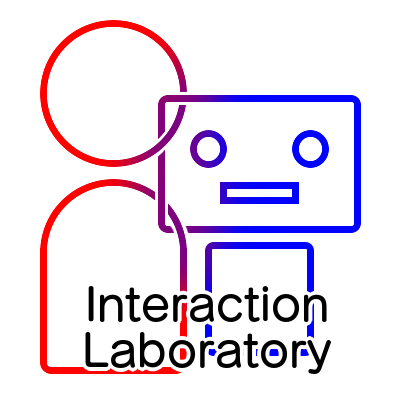

# 画像認識 講義用サンプルコード

**立命館大学 情報理工学部「実世界情報処理」教材**

講義で動かして見せた Python + OpenCV のサンプルプログラムです。
自分のパソコンで動かして、パラメータを変えたり処理を書き換えたりしてみてください。

| ファイル | 内容 |
| --- | --- |
| `capture.py` | Webカメラの画像を1フレームずつ取り込み、キー操作で選んだ画像処理（フィルタ・エッジ・二値化・ラベリング・オプティカルフロー・顔検出など）を行って表示します |
| `flann.py` | SIFT などの局所特徴の対応付けから RANSAC で射影変換行列を推定し、カメラ画像中の平面物体（本の表紙など）を検出します |
| `setup.sh` / `setup.bat` | セットアップ用（仮想環境の作成とモジュールのインストール） |
| `check_env.py` | 環境チェック用（モジュールが入っているか、各アルゴリズムやカメラが使えるか） |
| `models/` | 顔検出用の学習済みモデル（Haar-like カスケード、YuNet） |

## 必要なもの

- Python 3.8 以上（3.10〜3.13 推奨）
- Webカメラ（ノートPC内蔵カメラで OK）
- git（なくても ZIP でダウンロードできます）

Python が入っているかは、ターミナル（Windows は「コマンドプロンプト」または「PowerShell」）で次のように確認できます。

```
python --version
```

（macOS / Linux では `python3 --version` の場合もあります。以下 `python` を `python3` に読み替えてください。）

## 1. ダウンロード

```
git clone https://github.com/NobutakaShimada/cv-lecture-samples.git
cd cv-lecture-samples
```

git を使わない場合は、GitHub のページの緑色の **Code** ボタン → **Download ZIP** でダウンロードして展開し、ターミナルでそのフォルダに移動（`cd`）してください。

## 2. セットアップ（最初の1回だけ）

このフォルダの中に専用の**仮想環境**（`.venv` フォルダ）を作り、必要なモジュールをその中にインストールします。
パソコン全体の Python には何もインストールしないので、**すでに OpenCV などが入っていても衝突しません**。

**macOS / Linux**（ターミナルで、このフォルダに移動してから）

```
sh setup.sh
```

**Windows**

エクスプローラーで `setup.bat` を**ダブルクリック**するか、コマンドプロンプトでこのフォルダに移動してから次を実行します。

```
setup.bat
```

`numpy` と `opencv-contrib-python` がインストールされ、最後に環境チェック（`check_env.py`）の結果が表示されます。
すべて `[OK]` になれば準備完了です。`[--]` は参考情報なので気にしなくて構いません。
`[NG]` があれば、表示される指示に従ってください。

うまくいかないときは、仮想環境を作り直してみてください（`sh setup.sh --clean` / `setup.bat --clean`）。

> **なぜ opencv-contrib-python なのか**
> OpenCV 5 では、Haar-like 特徴による顔検出（`CascadeClassifier`）や KAZE / AKAZE / BRISK などの
> 古典的なアルゴリズムが本体（`opencv-python`）から外れ、拡張版（`opencv-contrib-python`）に移りました。
> この講義では原理を学ぶために古典的な手法も使うので、拡張版を入れています。
> 拡張版は本体の機能もすべて含んでいます。OpenCV 4.8 以降であれば 4.x でも 5.x でも動きます。

## 3. 仮想環境を有効にする（ターミナルを開くたびに毎回）

プログラムを実行する前に、次のコマンドで仮想環境を有効にします。

| 環境 | コマンド |
| --- | --- |
| macOS / Linux | `source .venv/bin/activate` |
| Windows（コマンドプロンプト） | `.venv\Scripts\activate` |
| Windows（PowerShell） | `.venv\Scripts\Activate.ps1` |

プロンプトの先頭に `(.venv)` と表示されれば OK です。
これを忘れると、パソコン全体の Python（OpenCV が入っていない、または古い版）で実行されてしまいます。
`python check_env.py` を実行すると、仮想環境で動いているかどうかを確認できます。

> PowerShell で「スクリプトの実行が無効」と言われたら、
> `Set-ExecutionPolicy -Scope CurrentUser RemoteSigned` を一度実行してから再度試すか、コマンドプロンプトを使ってください。

> **Anaconda を使っている人へ**: プロンプトに `(base)` と `(.venv)` の両方が表示されていても問題ありません。
> `(.venv)` が表示されていることを確認してください。

<details>
<summary>セットアップスクリプトを使わずに手動で行う場合</summary>

macOS / Linux:

```
python3 -m venv .venv
source .venv/bin/activate
python -m pip install --upgrade pip
python -m pip install -r requirements.txt
python check_env.py
```

Windows:

```
python -m venv .venv
.venv\Scripts\activate
python -m pip install --upgrade pip
python -m pip install -r requirements.txt
python check_env.py
```

</details>

## 4. 実行

### capture.py — カメラ画像のリアルタイム処理

```
python capture.py          # カメラ 0 を使う
python capture.py 1        # 外付けカメラなど、別のカメラを使う
python capture.py movie.mp4   # カメラの代わりに動画ファイルを使う
```

画像ウィンドウをクリックして選択した状態で、以下のキーを押すと処理が切り替わります。

| キー | 処理 | キー | 処理 |
| --- | --- | --- | --- |
| `c` | カラー（そのまま） | `l` | ラベリング |
| `g` | グレースケール | `;` | ラベリング＋外接矩形・重心 |
| `x` | Sobel フィルタ（x方向） | `f` | 密なオプティカルフロー（Farneback） |
| `y` | Sobel フィルタ（y方向） | `t` | 特徴点追跡（Lucas-Kanade） |
| `s` | 勾配強度 | `F` | 顔検出（Haar-like 特徴・Viola-Jones 法） |
| `a` | 勾配方向（色）と強度 | `Y` | 顔検出（YuNet・CNN） |
| `h` | 色相のみ | `U` | 上半身検出（Haar-like 特徴） |
| `b` | 二値化（大津の方法） | `d` | DoG フィルタ |
| `:` | SIFT 特徴点 | `e` | ヒストグラム平坦化 |
| `u` | **自作の処理**（後述） | `E` | 適応的ヒストグラム平坦化（CLAHE） |

前処理（ぼかし）:

| キー | 処理 |
| --- | --- |
| `G` | ガウシアンぼかし |
| `m` | メディアンフィルタ |
| `B` | バイラテラルフィルタ |
| `↑` / `+` | ぼかしを強く（DoG の大きさも変わります） |
| `↓` / `-` | ぼかしを弱く |
| `ESC` | ぼかしをリセット |

その他: `p` 顔検出（`F`）中に横顔検出の ON/OFF、`?` ヘルプ表示の ON/OFF、`q` 終了

起動するとキー操作の一覧がウィンドウに重ねて表示されます（背景は暗くなります）。`?` キーで消したり表示したりできます。選択中の処理は黄色で表示されます。
OpenCV 5 では日本語、OpenCV 4 では英語で表示されます（OpenCV 4 は日本語の文字を描けないため）。起動時に表示したくない場合は、`capture.py` 先頭の `SHOW_HELP_AT_START` を `False` にしてください。

#### 顔検出の古典的手法と CNN を比べてみる

- `F`: **Haar-like 特徴 + AdaBoost + カスケード**（Viola-Jones 法, 2001）。正面顔（青）、目（緑）、横顔（赤）を検出します。
- `Y`: **YuNet**（小さな CNN による顔検出器, OpenCV 4.8 以降で標準搭載）。顔の枠に加えて、目・鼻・口の両端の5点と信頼度を表示します。

顔を傾けたり、横を向いたり、手で一部を隠したりして、2つの手法の違いを確かめてみてください。

#### 自分で処理を書いてみる

`capture.py` の中の `proc_custom` 関数を書き換えて、実行中に `u` キーを押すと自分の処理が実行されます。
入力 `img` は BGR カラー画像（NumPy 配列）で、カラー画像またはグレースケール画像を返せば表示されます。

```python
def proc_custom(img, st):
    gray = cv2.cvtColor(img, cv2.COLOR_BGR2GRAY)
    edges = cv2.Canny(gray, 50, 150)
    return edges
```

新しいキーに割り当てたい場合は、`PROCS` という辞書に1行追加してください。

### flann.py — 特徴点マッチングと RANSAC による平面物体検出

```
python flann.py                        # カメラ画像からテンプレートを選ぶ
python flann.py --template book.jpg    # 画像ファイルをテンプレートにする
python flann.py --feature akaze        # 特徴量を変える
python flann.py --method magsac        # ロバスト推定法を変える
```

1. 起動するとカメラ映像が表示されます。本の表紙やお菓子の箱など、**模様の多い平らな物体**を映してスペースキーを押します。
2. 静止画上でマウスをドラッグして物体を囲み、Enter で決定します（`c` でやり直し）。
3. 物体を動かしたり傾けたりすると、検出された位置が水色の四角で表示されます。緑の線は RANSAC でインライアと判定された対応点です。

キー操作: `t` テンプレートを選び直す、`ESC` / `q` 終了

オプション:

| オプション | 説明 |
| --- | --- |
| `--camera 1` | カメラ番号（`python flann.py 1` でも可） |
| `--template ファイル名` | テンプレート画像 |
| `--feature 名前` | 局所特徴量の種類（下表、既定は `sift`） |
| `--method ransac` / `magsac` | 射影変換のロバスト推定法（既定は `ransac`） |
| `--ratio 0.7` | Lowe の ratio test の閾値（小さいほど厳しい） |
| `--scale 0.5` | 処理時にカメラ画像を縮小する倍率 |

局所特徴量:

| `--feature` | 手法 | 記述子 | FLANN の探索法 |
| --- | --- | --- | --- |
| `sift` | SIFT (2004) | 実数 128次元 | kd-tree |
| `surf` | SURF (2006) | 実数 64次元 | kd-tree |
| `kaze` | KAZE (2012) | 実数 64次元 | kd-tree |
| `akaze` | AKAZE (2013) | バイナリ | LSH |
| `brisk` | BRISK (2011) | バイナリ | LSH |
| `orb` | ORB (2011) | バイナリ | LSH |

> **SURF について**: SURF は特許の関係で、pip で配布されている OpenCV ではビルド時に無効化されているため、通常は使えません（`--feature surf` を指定するとその旨が表示されます）。
> 同じ考え方の手法として、SIFT（特許切れのため標準搭載）や KAZE を試してください。

ロバスト推定法:

- `ransac`: 古典的な RANSAC。ランダムに選んだ4組の対応点から射影変換を求め、インライア数が最大のものを選びます。
- `magsac`: MAGSAC++。インライアかどうかを閾値で二分せず、残差に応じた重みで評価する、比較的新しい手法です（OpenCV 4.5 以降）。

## うまく動かないとき

- **カメラ画像が取れない / 真っ黒**
  - `python capture.py 1` のようにカメラ番号を変えてみる
  - Zoom や Teams など、カメラを使っている他のアプリを終了する
  - **macOS**: 初回はカメラへのアクセス許可を求められます。許可しなかった場合は「システム設定 → プライバシーとセキュリティ → カメラ」で、使っているターミナル（ターミナル.app、VS Code など）を ON にして、ターミナルを再起動してください
  - **Windows**: 「設定 → プライバシーとセキュリティ → カメラ」で「デスクトップアプリがカメラにアクセスできるようにする」を ON にする
- **キーを押しても反応しない**: ターミナルではなく、画像ウィンドウをクリックしてから押してください。日本語入力（IME）がオンだと効かないことがあります
- **矢印キーが効かない**: `+` / `-` キーを使ってください
- **`ModuleNotFoundError: No module named 'cv2'`**、**`cv2.imshow` で "The function is not implemented" エラー**、**「AKAZE / CascadeClassifier が使えません」と表示される**:
  仮想環境が有効になっていない可能性があります。プロンプトに `(.venv)` が表示されているか確認してください（「3. 仮想環境を有効にする」）。
  それでも直らなければ、`sh setup.sh --clean`（Windows は `setup.bat --clean`）で仮想環境を作り直してください
- **`python3 -m venv` が失敗する（Ubuntu など）**: `sudo apt install python3-venv` を実行してから再度セットアップしてください
- **Windows で Python を入れたのに見つからない**: Python のインストーラーで「Add python.exe to PATH」にチェックを入れてインストールし直してください
- **`pip` が見つからない**: `python -m pip ...` の形で実行してください
- **動作が重い**: `capture.py` 先頭の `PROC_SCALE` や `flann.py` の `--scale` を小さくすると速くなります

## 終了したら・削除するとき

仮想環境から抜けるには `deactivate` を実行します。
不要になったら、このフォルダごと削除すれば、インストールしたモジュールもすべて消えます（パソコン全体には何も残りません）。

## ライセンス

このリポジトリのプログラムは [MIT License](LICENSE) で公開しています。
ただし、`models/` の学習済みモデルはそれぞれのライセンスに従います（下記）。
また、研究室のロゴ（`images/interaction_lab_logo.png`）は MIT License の対象外です。

## 同梱している学習済みモデルについて

| ファイル | 出典 | ライセンス |
| --- | --- | --- |
| `models/haarcascades/*.xml` | [OpenCV](https://github.com/opencv/opencv/tree/4.x/data/haarcascades) | Intel License Agreement（各ファイル先頭に記載） |
| `models/face_detection_yunet_2023mar.onnx` | [OpenCV Zoo / YuNet](https://github.com/opencv/opencv_zoo/tree/main/models/face_detection_yunet) | MIT License（`models/LICENSE_YuNet`） |

Haar-like カスケードのファイルは OpenCV 4.x の pip 版には同梱されていましたが、OpenCV 5 の pip 版には含まれなくなったため、このリポジトリに同梱しています。
